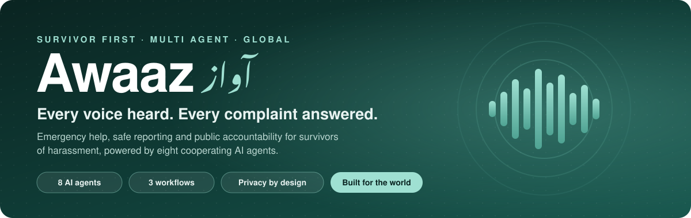
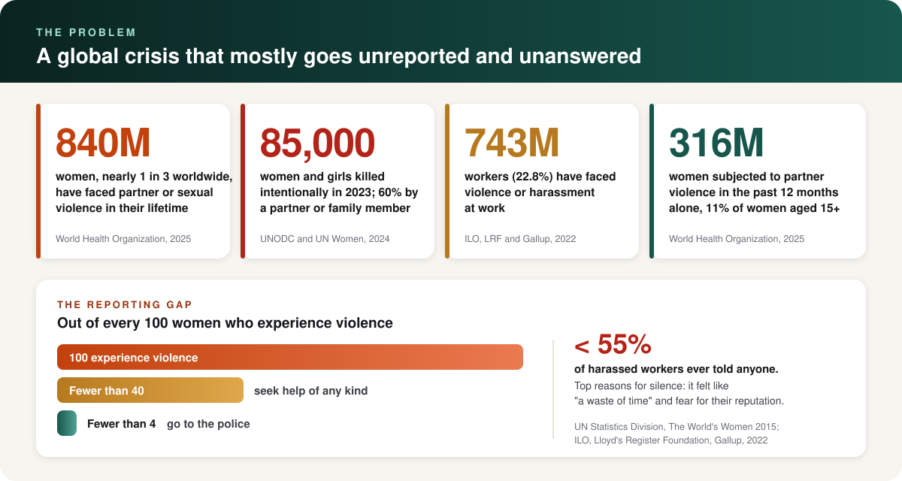
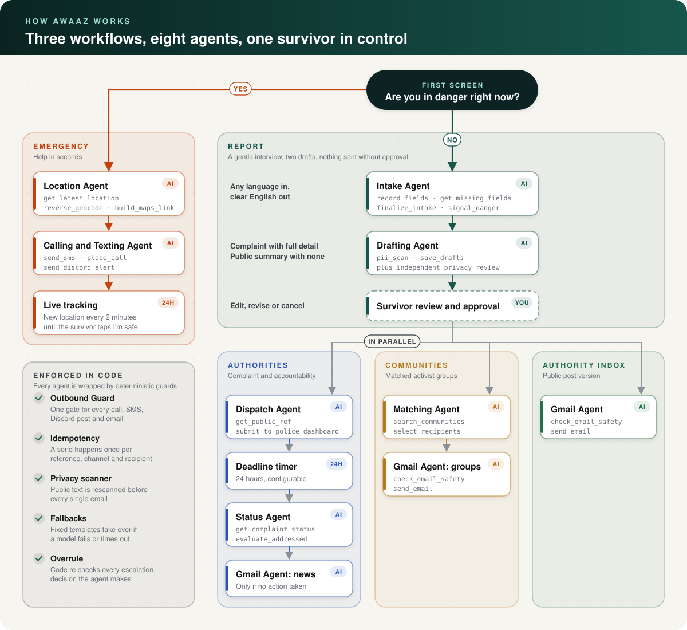
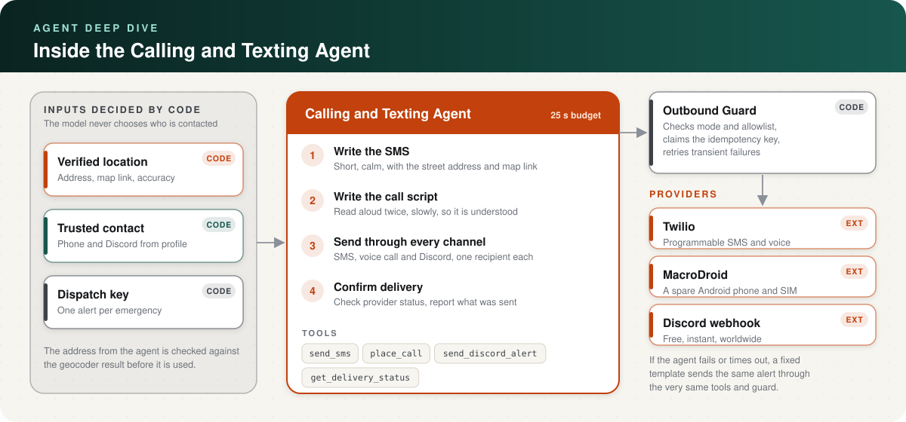
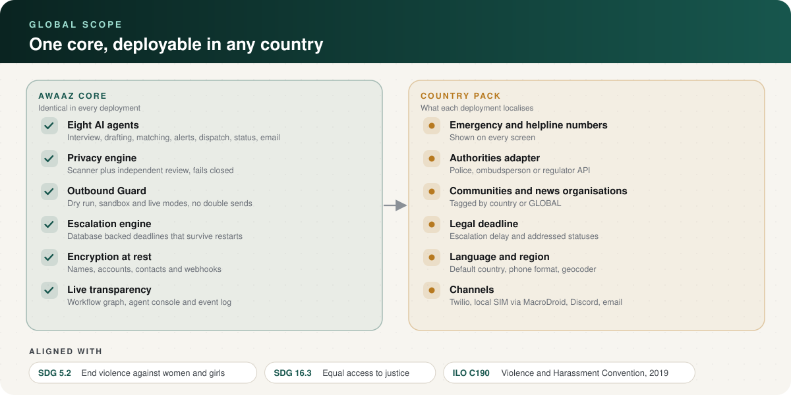
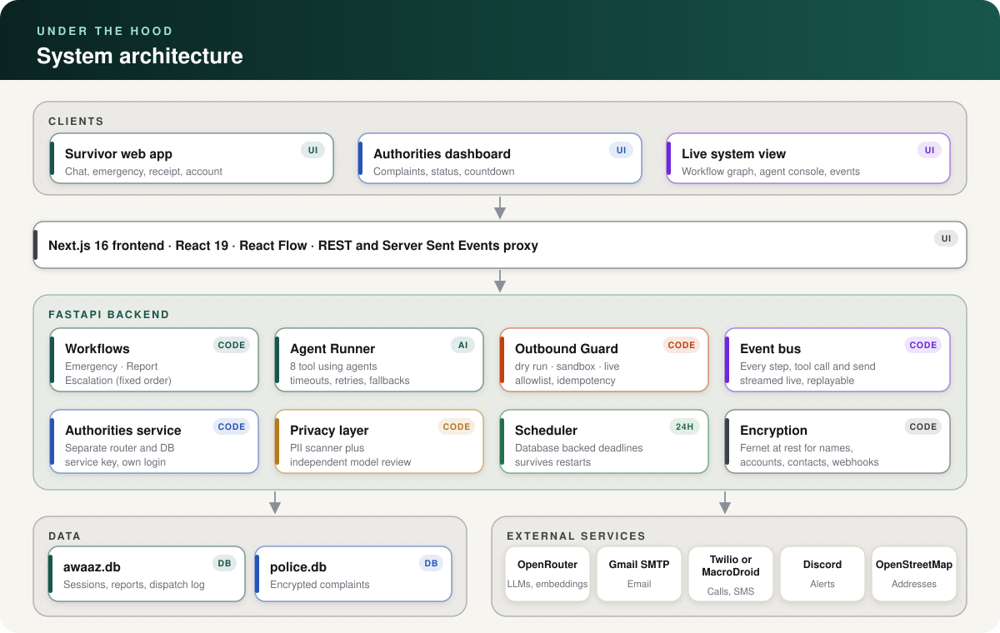

<p align="center">
  
</p>

<p align="center">
  
  
  
  
  
</p>

<p align="center">
  <a href="#the-problem"><b>Problem</b></a> &nbsp;·&nbsp;
  <a href="#the-solution"><b>Solution</b></a> &nbsp;·&nbsp;
  <a href="#how-it-works"><b>How it works</b></a> &nbsp;·&nbsp;
  <a href="#the-agents"><b>Agents</b></a> &nbsp;·&nbsp;
  <a href="#global-scope"><b>Global scope</b></a> &nbsp;·&nbsp;
  <a href="#architecture"><b>Architecture</b></a> &nbsp;·&nbsp;
  <a href="#getting-started"><b>Getting started</b></a>
</p>

<br>

> [!IMPORTANT]
> Awaaz is not a substitute for emergency services. If you are in immediate danger, call your local emergency number first.

**Awaaz** (Urdu for *voice*) is a survivor first, multi agent platform for people facing harassment and gender based violence. It turns one simple question, **"Are you in danger right now?"**, into one of two guided paths: an emergency path that gets the survivor's live location to a trusted person within seconds, and a reporting path that files a complaint with the authorities, shares an anonymised version with the communities able to amplify it, and automatically escalates to the press if nobody acts.

Every step is carried out by a specialised AI agent with its own tools, while every decision that affects safety (who is contacted, what is published, when to escalate) is enforced in code.

<br>

## The problem

<p align="center">
  
</p>

Violence and harassment against women is one of the most widespread human rights violations in the world. Nearly **1 in 3 women, about 840 million**, have experienced partner or sexual violence in their lifetime, a figure that has **barely changed since 2000**, with intimate partner violence falling by only **0.2 percent a year** over two decades. In 2023, **85,000 women and girls were killed intentionally**, and **51,100** of them were killed by a partner or family member: **one every 10 minutes**. At work, **743 million people** have experienced violence or harassment.

Yet the system rarely hears about it. In most countries, **fewer than 40 percent** of women who experience violence seek help of any kind, and **fewer than 10 percent** of those go to the police. Among workers who were harassed, **fewer than 55 percent ever told anyone**, most often because reporting felt like **"a waste of time"** or because they **feared for their reputation**.

The failure has four parts, and Awaaz is designed around all of them:

<table>
  <tr>
    <td width="50%" valign="top">
      <h3>Reporting gap</h3>
      Formal reporting is intimidating, procedural and exhausting, so most survivors never begin.
      <br><br><b>Awaaz:</b> a gentle conversational interview in the survivor's own words and language.
    </td>
    <td width="50%" valign="top">
      <h3>Accountability gap</h3>
      A filed complaint can sit untouched, with no visibility and no consequence for inaction.
      <br><br><b>Awaaz:</b> a deadline on every complaint and automatic escalation to the press.
    </td>
  </tr>
  <tr>
    <td width="50%" valign="top">
      <h3>Privacy risk</h3>
      Going public to create pressure usually means giving up anonymity.
      <br><br><b>Awaaz:</b> a public summary that is scanned and reviewed until it contains no identifying detail.
    </td>
    <td width="50%" valign="top">
      <h3>Emergency gap</h3>
      In danger, a survivor may be unable to speak, explain where she is, or make several calls.
      <br><br><b>Awaaz:</b> one tap sends her live location to a trusted person by SMS, call and Discord.
    </td>
  </tr>
</table>

<br>

## The solution

<table>
  <tr>
    <th width="33%">Emergency</th>
    <th width="33%">Report</th>
    <th width="33%">Escalate</th>
  </tr>
  <tr>
    <td valign="top">The survivor taps <b>Yes</b>. Her GPS location, a street address and a map link reach her trusted contact by SMS, voice call and Discord, and updates keep flowing every two minutes until she taps <b>I'm safe</b>.</td>
    <td valign="top">The survivor taps <b>No</b> and describes what happened. Awaaz drafts a full complaint and an anonymised public summary. After her approval, the complaint goes to the authorities and the summary goes to matched communities and an authority inbox.</td>
    <td valign="top">Every complaint carries a deadline, 24 hours by default. If the authorities have not acted when it passes, Awaaz emails news organisations the full anonymised case and states clearly that no action was taken.</td>
  </tr>
</table>

<br>

## How it works

<p align="center">
  
</p>

1. **Danger check.** The first screen asks one question with two large buttons.
2. **Emergency path.** The Location Agent resolves the survivor's coordinates into an address and map link, the Calling and Texting Agent alerts her trusted contact, and live tracking continues until she is safe.
3. **Report path.** The Intake Agent interviews her, the Drafting Agent writes both texts and proves the public one is free of personal information, and she approves, edits or cancels.
4. **Delivery, in parallel.** The Dispatch Agent files the complaint and starts the deadline, the Matching Agent picks relevant communities for the Gmail Agent to email, and the Gmail Agent sends the social media version to the authority inbox.
5. **Escalation.** At the deadline, the Status Agent checks the complaint. If it was not addressed, code re verifies every guard and the Gmail Agent emails news organisations.

The entire run is visible live in the interface: a workflow graph with the current state of every agent, an agent console with each tool call, its arguments and its result, and a complete event log.

<br>

## The agents

Awaaz runs **eight agents**. Each one is a language model given a specific goal and a small set of tools that it must call to get anything done. Agents never contact anyone directly; every tool runs through the same deterministic guards.

<table>
  <tr>
    <th align="left">Agent</th>
    <th align="left">Role</th>
    <th align="left">Tools it calls</th>
  </tr>
  <tr>
    <td><b>Intake Agent</b></td>
    <td>Interviews the survivor one question at a time and fills a structured case record.</td>
    <td><code>record_fields</code> <code>get_missing_fields</code> <code>finalize_intake</code> <code>signal_danger</code></td>
  </tr>
  <tr>
    <td><b>Drafting Agent</b></td>
    <td>Writes the complaint and the anonymised summary, retrying until the summary passes the scan.</td>
    <td><code>pii_scan</code> <code>save_drafts</code></td>
  </tr>
  <tr>
    <td><b>Location Agent</b></td>
    <td>Turns the latest GPS fix into a street address and a shareable map link.</td>
    <td><code>get_latest_location</code> <code>reverse_geocode</code> <code>build_maps_link</code></td>
  </tr>
  <tr>
    <td><b>Calling and Texting Agent</b></td>
    <td>Writes and sends the emergency SMS, call script and Discord alert, then confirms delivery.</td>
    <td><code>send_sms</code> <code>place_call</code> <code>send_discord_alert</code> <code>get_delivery_status</code></td>
  </tr>
  <tr>
    <td><b>Dispatch Agent</b></td>
    <td>Files the full complaint with the authorities service and records its reference.</td>
    <td><code>get_public_ref</code> <code>submit_to_police_dashboard</code></td>
  </tr>
  <tr>
    <td><b>Matching Agent</b></td>
    <td>Scores the case against every community's focus and selects who should receive it.</td>
    <td><code>search_communities</code> <code>select_recipients</code></td>
  </tr>
  <tr>
    <td><b>Gmail Agent</b></td>
    <td>Writes and sends outreach in three modes: communities, authority inbox and news.</td>
    <td><code>check_email_safety</code> <code>send_email</code></td>
  </tr>
  <tr>
    <td><b>Status Agent</b></td>
    <td>Checks a complaint at its deadline and decides whether it must be escalated.</td>
    <td><code>get_complaint_status</code> <code>evaluate_addressed</code> <code>trigger_news_escalation</code></td>
  </tr>
</table>

<br>

### Inside the Calling and Texting Agent

<p align="center">
  
</p>

This agent carries the most urgent job in the system, so its logic is deliberately layered:

* **Inputs come from code, not the model.** The trusted contact is resolved from the survivor's profile, and the location report is produced by the Location Agent and then checked against the geocoder result. The agent cannot invent a recipient or an address.
* **The model writes; the tools deliver.** The agent composes a short, calm SMS containing the street address and map link, and a call script that is read aloud twice, slowly. It then calls `send_sms`, `place_call` and `send_discord_alert`, one recipient per call, and checks `get_delivery_status`.
* **Every send passes the Outbound Guard.** The guard enforces the outbound mode and allowlist, claims an idempotency key so the same alert is never sent twice, and retries transient provider failures.
* **Providers are interchangeable.** Calls and texts can go through Twilio, through a spare Android phone with a local SIM running MacroDroid (free in any country), or through a Discord webhook. The survivor also gets one tap **Call now** and **Text location** buttons that use her own phone.
* **It cannot fail silently.** The agent has a 25 second budget. If it errors or runs out of time, a fixed template sends the same alert through the same tools and guard.
* **It keeps going.** After the first alert, location updates are sent every two minutes (up to ten by default) until the survivor taps **I'm safe**, which sends a final reassurance message and stops tracking.

<br>

## Global scope

<p align="center">
  
</p>

Violence against women occurs in every country, and the barriers to reporting it are strikingly similar everywhere: fear, stigma, slow institutions and no visibility into what happens next. Awaaz is built as a **global platform** with a single core and a thin, configurable layer for each country. It was first configured and demonstrated for Pakistan, but the design is country agnostic from the data model upward.

**Who it serves**

* **Survivors** of workplace, street, campus, domestic, transport and online harassment, anywhere, without needing an account or an identity.
* **Authorities** such as police, ombudspersons, workplace inquiry committees and regulators, through a dashboard or an API adapter.
* **Civil society**: human rights groups, women's networks and digital safety collectives, local or international.
* **The press**, as the accountability layer of last resort.

**How it scales across countries**

* **Country aware data model.** Every session, account, community and news organisation carries a country. Matching considers only organisations serving the survivor's country plus those tagged `GLOBAL`, so international networks can receive cases from anywhere.
* **Any language in.** Survivors write in the language they are most comfortable with. Drafts are produced in clear, simple English so that authorities, communities and journalists in any country can act on them, and matching uses multilingual embeddings.
* **International by default.** Phone numbers are normalised to the E.164 international format, addresses come from OpenStreetMap, which covers the entire world, and email and Discord work everywhere.
* **Works where telephony is expensive.** The MacroDroid option uses any local SIM card, and one tap calling uses the survivor's own phone, so emergency alerts do not depend on a commercial provider being available in that country.
* **Local law as configuration.** The escalation deadline, the statuses that count as addressed, the default country and the matching thresholds are configuration values, so each deployment can follow local procedure.
* **Pluggable authorities.** The authorities service sits behind its own API and service key. Replacing the demo dashboard with an adapter for a real national complaint system does not touch the agents or workflows.

**What a new country needs.** A country pack: its emergency and helpline numbers, an adapter or dashboard for the receiving authority, a verified list of communities and news organisations with agreed terms, the local deadline, and a messaging channel.

**Global alignment.** Awaaz directly supports **UN Sustainable Development Goal 5.2** (eliminate all forms of violence against all women and girls), **SDG 16.3** (equal access to justice for all), and the aims of the **ILO Violence and Harassment Convention, 2019 (No. 190)**, the first international treaty to recognise everyone's right to a world of work free from violence and harassment.

<table>
  <tr>
    <th width="50%" align="left">In scope</th>
    <th width="50%" align="left">Out of scope</th>
  </tr>
  <tr>
    <td valign="top">
      Emergency alerting to a trusted contact<br>
      Guided reporting and complaint filing<br>
      Anonymised public outreach to communities<br>
      Deadline tracking and press escalation<br>
      Multi country, multi language deployments
    </td>
    <td valign="top">
      Replacing emergency services or dispatching them<br>
      Legal advice or representation<br>
      Investigating or verifying allegations<br>
      Publishing directly to social media on the survivor's behalf<br>
      Identifying or naming accused persons publicly
    </td>
  </tr>
</table>

<br>

## Safety and privacy by design

Awaaz treats every model output as untrusted. These guarantees hold even if a model misbehaves, because they are enforced in code.

<table>
  <tr>
    <td width="50%" valign="top"><b>No personal information goes public.</b><br>A deterministic scanner and an independent model review must both pass. The scan runs again at confirmation and inside every email send. If cleanliness cannot be confirmed, nothing is shared publicly, while the complaint to the authorities still goes through.</td>
    <td width="50%" valign="top"><b>Only approved recipients are contacted.</b><br>Recipients are chosen by code from scores it computed itself. An agent cannot email or message anyone outside the approved list for its step.</td>
  </tr>
  <tr>
    <td valign="top"><b>Nothing is sent twice.</b><br>Every send claims a unique key of reference, channel and recipient in the dispatch log before it is attempted.</td>
    <td valign="top"><b>Escalation only when justified.</b><br>Before any news email, code re checks cancellation, privacy status and the live complaint status, and overrules the agent if they disagree.</td>
  </tr>
  <tr>
    <td valign="top"><b>Help goes out even if AI fails.</b><br>Deterministic fallbacks exist for the alert, the call, the interview, the complaint submission and every email.</td>
    <td valign="top"><b>Nothing leaves by accident.</b><br>One Outbound Guard is the only path to calls, SMS, Discord and email, with <code>dry_run</code>, <code>sandbox</code> and <code>live</code> modes.</td>
  </tr>
  <tr>
    <td valign="top"><b>Encrypted at rest.</b><br>Complainant names, full accounts, trusted contacts, webhook URLs and account profiles are encrypted with Fernet. Complaints live in a separate database reachable only through the authorities service.</td>
    <td valign="top"><b>Minimal retention and discretion.</b><br>Transcripts are purged after sending, the police reference is never shared publicly, survivors can stay anonymous, and a discreet mode and quick exit (Escape twice) hide the site instantly.</td>
  </tr>
</table>

<br>

## Architecture

<p align="center">
  
</p>

<table>
  <tr>
    <td width="25%" valign="top"><b>Backend</b><br>Python 3.12, FastAPI, Uvicorn, SQLAlchemy with SQLite, Pydantic, LangChain and LangGraph, httpx, cryptography</td>
    <td width="25%" valign="top"><b>Frontend</b><br>Next.js 16, React 19, TypeScript, Tailwind CSS 4, React Flow, Lucide</td>
    <td width="25%" valign="top"><b>AI</b><br>OpenRouter models, DeepSeek V4 Flash by default, BGE M3 multilingual embeddings, offline fallbacks</td>
    <td width="25%" valign="top"><b>Channels</b><br>Gmail SMTP, Twilio, MacroDroid, Discord webhooks, OpenStreetMap Nominatim, Google Maps</td>
  </tr>
</table>

<br>

## Getting started

**Requirements:** Python 3.12 with [uv](https://docs.astral.sh/uv/), Node.js 20 or newer, and GNU Make (on Windows, `mingw32-make` from MSYS2 works).

```bash
cp .env.example .env
make install
make dev
```

`make dev` starts the backend on port 8000 and the frontend on `https://localhost:3000` with a self signed certificate. Accept the certificate warning once. Everything defaults to `dry_run`, so you can explore the whole product without contacting anyone.

<table>
  <tr>
    <td width="33%" valign="top"><b>On a phone</b><br>Join the same WiFi and open <code>https://&lt;your computer's IP&gt;:3000</code>. HTTPS is required because phones only share GPS with secure pages.</td>
    <td width="33%" valign="top"><b>Without an AI key</b><br>The app still runs end to end on its fallbacks. The public summary is held back, because it cannot be confirmed clean without the privacy review.</td>
    <td width="33%" valign="top"><b>Authorities dashboard</b><br>Open <code>/authorities</code> and sign in with <code>POLICE_DEMO_USER</code> and <code>POLICE_DEMO_PASSWORD</code>.</td>
  </tr>
</table>

<details>
<summary><b>Configuration reference</b></summary>

<br>

All settings live in [.env.example](.env.example).

<table>
  <tr><th align="left">Group</th><th align="left">Variables</th><th align="left">Purpose</th></tr>
  <tr><td><b>Outbound safety</b></td><td><code>OUTBOUND_MODE</code> <code>OUTBOUND_ALLOWLIST</code></td><td><code>dry_run</code> logs only, <code>sandbox</code> sends only to the allowlist, <code>live</code> sends to real recipients.</td></tr>
  <tr><td><b>Authorities</b></td><td><code>ALERT_AUTHORITIES</code> <code>AUTHORITY_NUMBER</code></td><td>Calling real emergency services, off by default.</td></tr>
  <tr><td><b>Recipients</b></td><td><code>AUTHORITY_EMAIL</code> <code>NEWS_AGENCY_EMAIL</code></td><td>Authority inbox for the post version, and an optional single news inbox for escalation.</td></tr>
  <tr><td><b>Defaults</b></td><td><code>DEFAULT_TRUSTED_CONTACT</code> <code>DEFAULT_DISCORD_WEBHOOK</code> <code>DEFAULT_COUNTRY</code></td><td>Used when a survivor has not set her own values.</td></tr>
  <tr><td><b>Demo inboxes</b></td><td><code>SEED_EMAIL_BASE</code> <code>COMMUNITY_EMAIL_BASE</code> <code>NEWS_EMAIL_BASE</code></td><td>Route fictional organisations to your inbox with plus addressing.</td></tr>
  <tr><td><b>AI</b></td><td><code>OPENROUTER_API_KEY</code> <code>MODEL_DEFAULT</code> <code>MODEL_DRAFTING</code> <code>AGENT_TIMEOUT_S</code></td><td>Models and the per agent timeout before fallbacks take over.</td></tr>
  <tr><td><b>Matching</b></td><td><code>EMBEDDING_PROVIDER</code> <code>EMBEDDING_MODEL</code> <code>MATCH_THRESHOLD</code> <code>MATCH_MARGIN</code> <code>MATCH_TOP_K</code></td><td>Community selection.</td></tr>
  <tr><td><b>Workflow</b></td><td><code>ESCALATION_DELAY_SECONDS</code> <code>ADDRESSED_STATUSES</code> <code>TRACKING_INTERVAL_S</code> <code>TRACKING_MAX_UPDATES</code> <code>PURGE_TRANSCRIPT</code></td><td>Deadline (86400 seconds by default), what counts as addressed, live tracking and retention.</td></tr>
  <tr><td><b>Security</b></td><td><code>DATA_ENCRYPTION_KEY</code> <code>POLICE_SERVICE_KEY</code> <code>POLICE_DEMO_USER</code> <code>POLICE_DEMO_PASSWORD</code> <code>ENABLE_DEMO_ROUTES</code></td><td>Encryption key (always set outside development), service secret, dashboard login and demo routes.</td></tr>
</table>

</details>

<details>
<summary><b>Integrations</b></summary>

<br>

**Gmail.** Enable two step verification, create an app password (Google Account, Security, App passwords), and set `SMTP_USER` and `SMTP_APP_PASSWORD`.

**Twilio.** Set `TWILIO_ACCOUNT_SID`, `TWILIO_AUTH_TOKEN` and `TWILIO_FROM_NUMBER`. Trial accounts reach only verified numbers, so add yours to `OUTBOUND_ALLOWLIST` and use `sandbox`.

**MacroDroid (free calls and SMS).** On a spare Android phone with a SIM, create a webhook macro `awaaz_call` that calls the trusted contact and, optionally, `awaaz_sms` that sends an SMS from the `to` and `text` variables. Set `CALL_PROVIDER=macrodroid`, `SMS_PROVIDER=macrodroid` and `MACRODROID_URL`.

**Discord.** The trusted contact creates a private channel and a webhook. The survivor pastes the URL in **Setup** and can send a test. In sandbox mode, add `discord:*` to the allowlist.

**Maps.** OpenStreetMap Nominatim is the default and needs no key; set `NOMINATIM_EMAIL` as its policy asks. `GEOCODER=google` with `GOOGLE_MAPS_API_KEY` switches to Google. Each is the other's fallback, and the alert still goes out with coordinates if both fail.

</details>

<br>

## Quality and evaluation

```bash
make test             # unit and integration tests: scripted LLM, fake providers, injected clock
make e2e              # drives both scenarios through a running backend; refuses live mode
make matching-eval    # checks each case ranks the right community first
make eval MODELS=a,b  # model selection evaluation (needs OPENROUTER_API_KEY)
make lint             # TypeScript type check and ESLint
```

The model is chosen by evaluation, not preference: the cheapest model that passes every check becomes the default.

<table>
  <tr>
    <th>Model</th>
    <th>Tool calls</th>
    <th>Privacy (30 cases in 3 languages)</th>
    <th>Interview quality</th>
    <th>Cost per full run</th>
  </tr>
  <tr>
    <td>DeepSeek V4 Flash</td>
    <td align="center"><b>9 / 9</b></td>
    <td align="center"><b>30 / 30</b></td>
    <td align="center"><b>10 / 10</b></td>
    <td align="center"><b>$0.0106</b></td>
  </tr>
</table>

The full method and results are in [docs/MODEL_CHOICE.md](docs/MODEL_CHOICE.md).

<br>

## Demo walkthrough

1. Run `make demo-reset` and open the home page; the workflow graph is idle.
2. Open **Setup**, add yourself as the trusted contact, and tap **Yes**. Watch the Location Agent and the Calling and Texting Agent work, with every tool call in the console.
3. Tap **I'm safe**, then start a new session.
4. Tap **No**, choose to report, and describe an incident. Watch the Intake and Drafting Agents.
5. Review both drafts and press **Send**. Dispatch, matching and email run in parallel.
6. Open `/authorities` in a second window; the complaint is there with a countdown.
7. Press the demo fast forward button. The Status Agent sees `NEW` and escalates to the news inbox.
8. Repeat after setting a complaint to `IN_PROGRESS`; this time there is no escalation.

<br>

## Project structure

```
backend/app/
  agents/       the eight agents and the AgentRunner
  workflows/    emergency, report and escalation workflows
  police/       authorities service: routes, service, client, database
  tools/        PII scanner, privacy review, similarity, maps
  api/          sessions, reports, accounts and event stream routes
  outbound.py   the single Outbound Guard
  crypto.py     encryption at rest
frontend/
  app/          home, how it works, account and authorities pages
  components/   chat, workflow graph, agent console, event log
  lib/          API client, live event stream, workflow state
evals/          model and matching evaluations
docs/           model choice report and README assets
```

<br>

## Roadmap

<table>
  <tr>
    <td width="50%" valign="top">
      <b>Next</b><br>
      Country packs with localised helplines<br>
      Adapters for real national complaint systems<br>
      Localised interface in more languages<br>
      Secure evidence uploads
    </td>
    <td width="50%" valign="top">
      <b>Later</b><br>
      WhatsApp and native mobile apps<br>
      Follow up updates to communities<br>
      Routing to agencies beyond the police<br>
      Production identity and multi factor login for authorities
    </td>
  </tr>
</table>

Seed organisations are fictional. Real organisations should be added only after agreeing terms with each one.

<br>

## References

1. World Health Organization. *Violence against women prevalence estimates*, November 2025: 840 million women, 316 million in the past year, 0.2 percent annual decline. [Coverage](https://epinews.emphnet.net/en/news/lifetime-toll-840-million-women-faced-partner-or-sexual-violence)
2. UNODC and UN Women. *Femicides in 2023: Global estimates of intimate partner and family member femicides*, November 2024. [Coverage](https://www.downtoearth.org.in/amp/story/governance/in-2023-a-woman-or-girl-was-killed-by-someone-she-trusted-every-10-minutes-un-report)
3. ILO, Lloyd's Register Foundation and Gallup. *Experiences of violence and harassment at work: A global first survey*, December 2022. [Summary](https://shknowledgehub.unwomen.org/sites/default/files/2023-05/Sp%20-%20Experiences%20of%20violence%20and%20harassment%20at%20work.pdf)
4. United Nations Statistics Division. *The World's Women 2015*, Chapter 6: Violence against women. [Report](https://unstats.un.org/unsd/gender/chapter6/chapter6.html)
5. International Labour Organization. *Violence and Harassment Convention, 2019 (No. 190).* [Text](https://normlex.ilo.org/dyn/nrmlx_en/f?p=NORMLEXPUB:12100:0::NO::P12100_ILO_CODE:C190)

<br>

<p align="center"><sub>Awaaz · Every voice heard. Every complaint answered.</sub></p>
